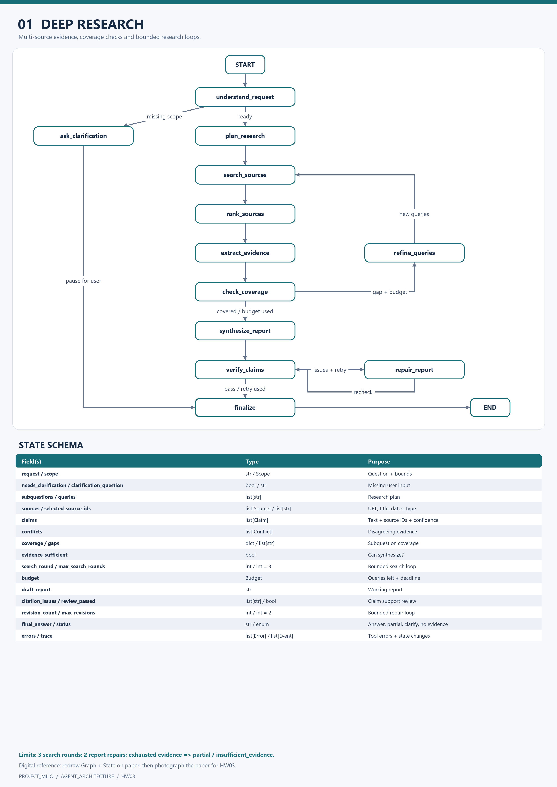
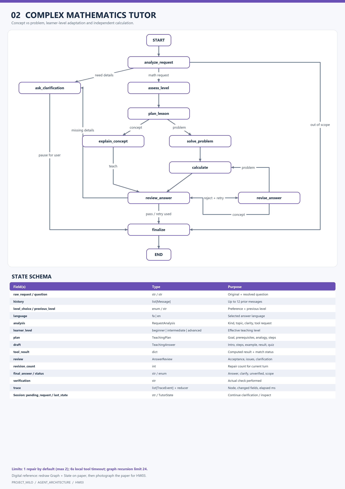
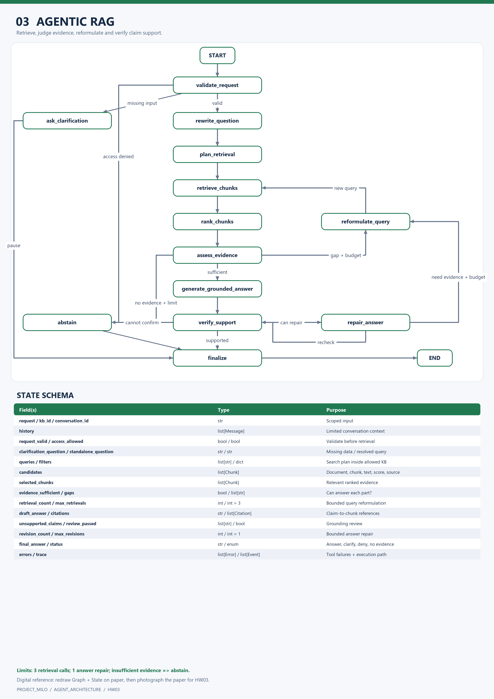
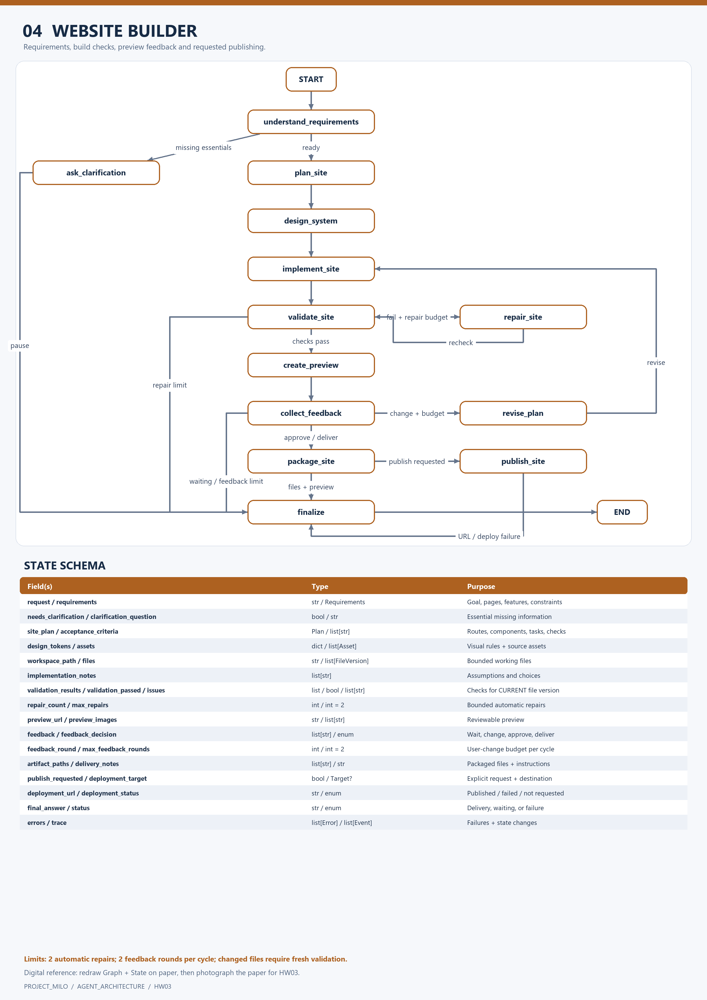

# تمرین سوم — طراحی معماری چهار ایجنت

**PROJECT_MILO: AGENT_ARCHITECTURE**

این پروژه طراحی Graph، Nodeها، مسیرهای شرطی و State Schema چهار ایجنت است. تصاویر مرجع برای رسم طرح روی کاغذ و مستندات فارسی برای توضیح تصمیم‌ها در این ریپو قرار دارند.

| ایجنت | طراحی کامل | تصویر قابل رسم/چاپ | گراف Mermaid |
|---|---|---|---|
| Deep Research | [طراحی](designs/01-deep-research.md) | [تصویر](diagrams/01-deep-research.png) | [Graph](graphs/01-deep-research.mmd) |
| Complex Mathematics Tutor | [طراحی](designs/02-math-tutor.md) | [تصویر](diagrams/02-math-tutor.png) | [Graph](graphs/02-math-tutor.mmd) |
| Agentic RAG | [طراحی](designs/03-agentic-rag.md) | [تصویر](diagrams/03-agentic-rag.png) | [Graph](graphs/03-agentic-rag.mmd) |
| Website Builder | [طراحی](designs/04-website-builder.md) | [تصویر](diagrams/04-website-builder.png) | [Graph](graphs/04-website-builder.mmd) |

## خروجی مطابق صورت تمرین

صورت تمرین می‌گوید: «پیاده‌سازی و کدنویسی انجام نشود و خروجی فقط عکس از روی کاغذ است.»

تصاویر پوشهٔ `diagrams` **مرجع دیجیتال طراحی** هستند. برای تحویل رسمی، گراف و State هر تصویر را روی کاغذ رسم کنید و از همان کاغذ عکس بگیرید. [راهنمای رسم و عکس](PAPER_SUBMISSION.md) توضیح می‌دهد چه مواردی در عکس دیده شوند. تصاویر دیجیتال این ریپو عکس یک طراحی دست‌نویس محسوب نمی‌شوند.

پیاده‌سازی مدرس ریاضی در [ریپوی جداگانهٔ تمرین چهارم](https://github.com/mohsenalipour/starcoach-hw04-math-tutor) قرار دارد. نام نودها، مسیرها، سقف اصلاح و State بخش ریاضی با آن پیاده‌سازی هماهنگ است.

## قواعد مشترک طراحی

- هر اجرا ورودی مشخص، State مشترک و یک نتیجهٔ پایان دارد.
- نودها کار را انجام می‌دهند و یال‌های شرطی مسیر بعدی را تعیین می‌کنند.
- دادهٔ ضروری ناقص به پرسش روشن‌کننده منتهی می‌شود؛ اجرا متوقف و بعد از پاسخ کاربر از نقطهٔ ورود مناسب آغاز می‌شود.
- حلقه‌های پژوهش، بازیابی یا اصلاح سقف دارند و پس از پایان بودجه نتیجهٔ محدود، درخواست اطلاعات یا عدم امکان پاسخ برمی‌گردانند.
- `trace` نام نود، تصمیم و تغییرات State را ثبت می‌کند؛ این trace برای فهم مسیر اجراست.
- متن منابع و اسناد، دادهٔ قابل بررسی محسوب می‌شود. تصمیم‌ها از سیاست و State ایجنت می‌آیند.

## تصمیم‌های معماری و محدودیت‌ها

هر ایجنت یک گراف اختصاصی دارد تا State و شرط‌های آن قابل مشاهده و قابل رسم باشند. تفکیک نود تولید پاسخ از نود بررسی، امکان اصلاح هدفمند را می‌دهد؛ هزینهٔ آن اجرای اضافهٔ مدل یا ابزار است. در طراحی آموزشی، حافظهٔ هر ایجنت و بودجهٔ حلقه‌ها کوچک و صریح نگه داشته می‌شود.

برای اجرای واقعی در مقیاس بزرگ، ذخیرهٔ پایدار State، نسخه‌بندی اسناد، cache ابزارها، صف اجرا، محدودیت هم‌زمانی و ثبت هزینه باید دوباره بررسی شوند. فعلاً تمرکز بر مسیر درست تصمیم‌گیری و خروجی قابل ارزیابی است.

## معیارهای امتیازدهی

برای هر ایجنت، Graph کامل، شرح Nodeها، انتقال‌ها، شرط‌ها، State Schema و نمونهٔ مسیر ارائه شده است. هر طراحی بخش ۵۰ امتیازی همان ایجنت را پوشش می‌دهد؛ امتیاز نهایی را ارزیاب تمرین تعیین می‌کند.

