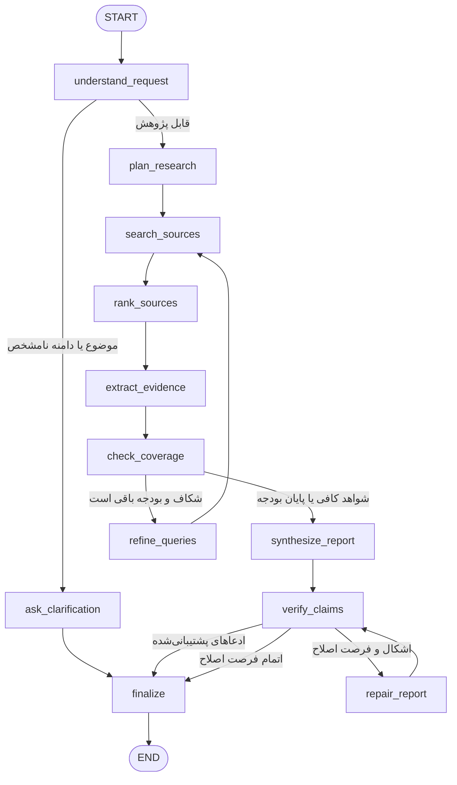

# ۱. Deep Research Agent

## هدف و فرض‌ها

دریافت سؤال پژوهشی، تبدیل آن به زیرسؤال، جست‌وجوی چندمنبعی، استخراج شواهد و ارائهٔ جمع‌بندی مستند. ابزارهای جست‌وجو و خواندن منابع در دسترس‌اند و هر منبع URL یا شناسهٔ قابل ارجاع دارد. محدودیت زمان و تعداد جست‌وجو از ابتدای اجرا مشخص است.

## Graph

## Nodeها و تغییر State

| نود | مسئولیت | فیلدهای تغییرکرده |
|---|---|---|
| `understand_request` | تعیین موضوع، دامنه، مخاطب، محدودیت تاریخ و ابهام | `scope`, `needs_clarification`, `clarification_question` |
| `ask_clarification` | طرح یک سؤال برای اطلاعات ضروری | `final_answer`, `status=needs_clarification` |
| `plan_research` | ساخت زیرسؤال و عبارت‌های جست‌وجو | `subquestions`, `queries` |
| `search_sources` | جست‌وجو با بودجهٔ محدود و ثبت نتایج | `sources`, `search_round`, `budget`, `errors` |
| `rank_sources` | حذف تکراری‌ها و رتبه‌بندی بر اساس ارتباط، اعتبار و تاریخ | `selected_source_ids` |
| `extract_evidence` | خواندن منابع و ثبت ادعا با شناسهٔ منبع | `claims`, `conflicts` |
| `check_coverage` | سنجش پوشش زیرسؤال‌ها، تازگی و تناقض شواهد | `coverage`, `gaps`, `evidence_sufficient` |
| `refine_queries` | ساخت عبارت دقیق‌تر از روی شکاف‌ها | `queries` |
| `synthesize_report` | ساخت جمع‌بندی و تفکیک یافتهٔ مستند از عدم قطعیت | `draft_report` |
| `verify_claims` | بررسی پشتوانهٔ هر ادعا، درست بودن ارجاع و تعارض‌ها | `citation_issues`, `review_passed` |
| `repair_report` | حذف ادعای بی‌منبع و اصلاح ارجاع یا بیان عدم قطعیت | `draft_report`, `revision_count` |
| `finalize` | پاسخ مستند یا محدود با اعلام شکاف‌ها، یا سؤال روشن‌کننده | `final_answer`, `status` |

## شرط‌ها

- دامنهٔ نامشخصی که پاسخ را عوض می‌کند به شفاف‌سازی می‌رود؛ ناشناخته بودن جزئیات کم‌اهمیت مانع شروع نیست.
- پوشش کافی یعنی زیرسؤال‌های اصلی شاهد دارند و اختلاف منابع مهم توضیح داده شده است.
- بازجست‌وجو فقط با وجود شکاف و `search_round < max_search_rounds`، سهمیهٔ باقی‌مانده و قبل از deadline انجام می‌شود.
- سقف دورهای جست‌وجو ۳ و سقف اصلاح گزارش ۲ است. پایان بودجه با شواهد ناکافی، گزارش محدود و وضعیت `partial` می‌دهد.
- اگر منبعی پیدا نشود، نتیجهٔ پژوهش ساخته نمی‌شود؛ خروجی `insufficient_evidence` است.
- پس از اتمام اصلاح، تنها ادعاهای دارای پشتوانه در خروجی باقی می‌مانند. منابع متناقض به عنوان اختلاف ثبت می‌شوند.

## State Schema

| فیلد | نوع | معنا |
|---|---|---|
| `request` | `str` | سؤال اصلی |
| `scope` | `{topic, audience, language, date_range, constraints}` | محدودهٔ پژوهش |
| `needs_clarification` | `bool` | نیاز به ورودی ضروری |
| `clarification_question` | `str` | سؤال روشن‌کننده |
| `subquestions` | `list[str]` | زیرسؤال‌ها |
| `queries` | `list[str]` | عبارت‌های دور فعلی |
| `sources` | `list[{id,url,title,published_at,accessed_at,type}]` | فهرست منابع و منشأ |
| `selected_source_ids` | `list[str]` | منابع انتخاب‌شده برای خواندن |
| `claims` | `list[{text,source_ids,subquestion_id,confidence}]` | ادعا و شاهد پشتیبان |
| `conflicts` | `list[{claim_ids,description}]` | اختلاف منابع |
| `coverage` | `dict[str,float]` | میزان پوشش زیرسؤال‌ها |
| `gaps` | `list[str]` | موارد بی‌پاسخ |
| `evidence_sufficient` | `bool` | کفایت شواهد |
| `search_round`, `max_search_rounds` | `int`, `int=3` | تعداد و سقف دور جست‌وجو |
| `budget` | `{remaining_queries:int, deadline:str}` | سقف ابزار و زمان |
| `draft_report` | `str` | گزارش اولیه |
| `citation_issues` | `list[str]` | ادعاهای بی‌پشتوانه یا ارجاع غلط |
| `review_passed` | `bool` | نتیجهٔ بررسی |
| `revision_count`, `max_revisions` | `int`, `int=2` | تعداد و سقف اصلاح |
| `final_answer` | `str` | پاسخ نهایی |
| `status` | `running/answered/partial/needs_clarification/insufficient_evidence` | پایان اجرا |
| `errors`, `trace` | `list[Error]`, `list[TraceEvent]` | خطاهای ابزار و مسیر اجرا |

فهرست منابع با `id/url` ادغام و تکراری‌ها حذف می‌شوند. ادعا بدون `source_ids` وارد پاسخ قطعی نمی‌شود. مقدارهای شمارنده افزایش می‌یابند و سقف بودجه کاهش می‌یابد؛ پیش‌نویس در اصلاح جایگزین می‌شود.

## مسیر نمونه و تصمیم معماری

سؤال «مزایا و محدودیت‌های باتری سدیم‌یون چیست؟» → برنامهٔ پژوهش → جست‌وجو → استخراج → نبود شاهد کافی دربارهٔ عمر چرخه → اصلاح عبارت → جست‌وجوی دوباره → جمع‌بندی → بررسی ارجاع → پاسخ. محدود بودن دورها هزینه را کنترل می‌کند؛ ممکن است پژوهش با شکاف پایان یابد. در مقیاس بزرگ، cache خواندن منابع و ذخیرهٔ snapshot شواهد برای بررسی مجدد لازم می‌شود.
