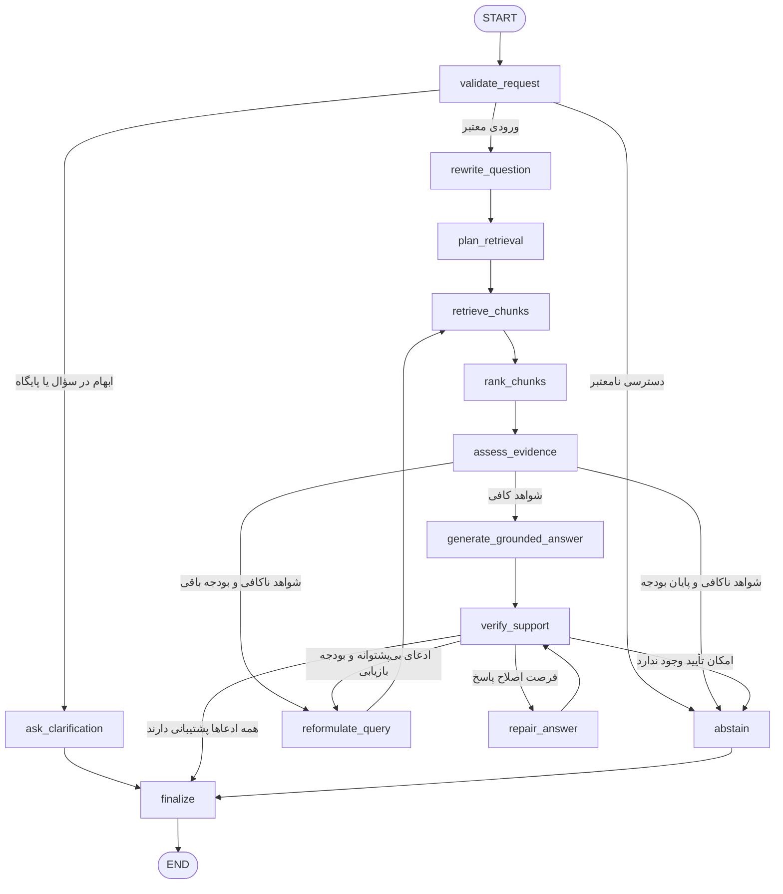

# ۳. Agentic RAG

## هدف و فرض‌ها

پاسخ مستند از یک پایگاه دانش مشخص با امکان تصمیم‌گیری برای بازیابی مجدد. ورودی شامل سؤال، شناسهٔ پایگاه دانش و زمینهٔ گفت‌وگو است. اسناد قبلاً استخراج، قطعه‌بندی و index شده‌اند؛ این گراف مربوط به پاسخ‌دهی است. بازیابی فقط در پایگاه مجاز همین درخواست انجام می‌شود.

## Graph

## Nodeها و تغییر State

| نود | مسئولیت | فیلدهای تغییرکرده |
|---|---|---|
| `validate_request` | بررسی سؤال، پایگاه، فیلترها و دسترسی | `request_valid`, `access_allowed`, `clarification_question`, `status` |
| `ask_clarification` | دریافت سؤال/پایگاه ضروری | `final_answer`, `status` |
| `rewrite_question` | تبدیل سؤال وابسته به سابقه به سؤال مستقل | `standalone_question` |
| `plan_retrieval` | انتخاب queryها و فیلترهای مجاز | `queries`, `filters` |
| `retrieve_chunks` | بازیابی فقط از پایگاه مجاز و ثبت منشأ | `candidates`, `retrieval_count`, `errors` |
| `rank_chunks` | رتبه‌بندی مجدد و حذف قطعهٔ بی‌ربط/تکراری | `selected_chunks` |
| `assess_evidence` | تعیین کفایت شواهد برای هر بخش سؤال | `evidence_sufficient`, `gaps` |
| `reformulate_query` | دقیق‌تر کردن query بر اساس شکاف یا ادعای بی‌پشتوانه | `queries` |
| `generate_grounded_answer` | تولید پاسخ فقط از قطعه‌های منتخب با ارجاع | `draft_answer`, `citations` |
| `verify_support` | تطبیق هر ادعا و ارجاع با متن قطعه | `unsupported_claims`, `review_passed` |
| `repair_answer` | حذف یا محدود کردن ادعاهای بدون شاهد | `draft_answer`, `citations`, `revision_count` |
| `abstain` | پاسخ روشن دربارهٔ نداشتن شاهد یا دسترسی | `final_answer`, `status` |
| `finalize` | نمایش پاسخ دارای ارجاع، سؤال یا اعلام عدم کفایت | `final_answer`, `status` |

## شرط‌ها

- بازنویسی سؤال فقط ارجاع‌های مکالمه را روشن می‌کند و عدد یا موضوع اصلی را تغییر نمی‌دهد.
- حداکثر سه بازیابی انجام می‌شود؛ `retrieval_count` در هر اجرای ابزار افزایش می‌یابد.
- بعد از بازیابی، کفایت شاهد بررسی می‌شود. نزدیک بودن embedding به‌تنهایی مجوز پاسخ نیست.
- اولویت پس از بررسی: تأیید پاسخ → بازیابی برای شواهد ناقص اگر فرصت باقی است → اصلاح با شواهد موجود اگر `revision_count < 1` → اعلام عدم کفایت.
- بازیابی جدید دوباره از `rank_chunks` و `assess_evidence` عبور می‌کند؛ تولید پاسخ از شواهد قبلی به‌طور خودکار تأیید نمی‌شود.
- اگر دسترسی نامعتبر باشد، ابزار بازیابی اجرا نمی‌شود. خروجی `access_denied` است.
- پایان بودجه با شواهد ناکافی، خروجی `insufficient_evidence` می‌دهد؛ دانش عمومی مدل جای متن پایگاه را پر نمی‌کند.

## State Schema

| فیلد | نوع | معنا |
|---|---|---|
| `request` | `str` | سؤال کاربر |
| `kb_id`, `conversation_id` | `str`, `str` | پایگاه دانش و گفت‌وگو |
| `history` | `list[Message]` | زمینهٔ محدود مکالمه |
| `request_valid`, `access_allowed` | `bool`, `bool` | نتیجهٔ اعتبارسنجی |
| `clarification_question` | `str` | اطلاعات ضروری ناقص |
| `standalone_question` | `str` | سؤال مستقل |
| `queries` | `list[str]` | عبارت‌های جست‌وجوی دور فعلی |
| `filters` | `dict` | فیلتر metadata در همان پایگاه مجاز |
| `candidates` | `list[{document_id,chunk_id,text,score,source}]` | نتایج بازیابی |
| `selected_chunks` | `list[Chunk]` | قطعه‌های منتخب با منشأ |
| `evidence_sufficient` | `bool` | کفایت شواهد |
| `gaps` | `list[str]` | بخش‌های سؤال فاقد شاهد |
| `retrieval_count`, `max_retrievals` | `int`, `int=3` | تعداد و سقف بازیابی |
| `draft_answer` | `str` | پاسخ اولیه |
| `citations` | `list[{claim_id,chunk_id,document_id,page}]` | اتصال ادعا به قطعه |
| `unsupported_claims` | `list[str]` | ادعاهای نیازمند شاهد یا حذف |
| `review_passed` | `bool` | نتیجهٔ بررسی |
| `revision_count`, `max_revisions` | `int`, `int=1` | تعداد و سقف اصلاح |
| `final_answer` | `str` | خروجی قابل نمایش |
| `status` | `running/answered/needs_clarification/access_denied/insufficient_evidence` | نتیجهٔ اجرا |
| `errors`, `trace` | `list[Error]`, `list[TraceEvent]` | خطا و مسیر اجرا |

قطعه‌ها با `chunk_id` ادغام می‌شوند و هر قطعه منشأ خود را حفظ می‌کند. پاسخ جدید و ارجاع‌ها در تولید/اصلاح جایگزین می‌شوند. هر درخواست جدید سقف بازیابی و اصلاح مستقل دارد؛ سؤال و سابقهٔ پایگاه دیگر وارد State آن نمی‌شود.

## مسیر نمونه و تصمیم معماری

«شرایط مرخصی استعلاجی چیست؟» → بازیابی آیین‌نامه → شاهد دربارهٔ مدارک پزشکی ناقص → reformulate → بازیابی بخش ضمیمه → پاسخ با ارجاع → بررسی پشتیبانی → پایان. این شاخهٔ بازیابی مجدد علت Agentic بودن گراف است. هزینهٔ آن query اضافه است؛ سقف سه دور پاسخ‌گویی را قابل کنترل می‌کند. با بزرگ شدن پایگاه، کیفیت chunking، reranking و نسخه‌بندی index نیازمند بازبینی است.
