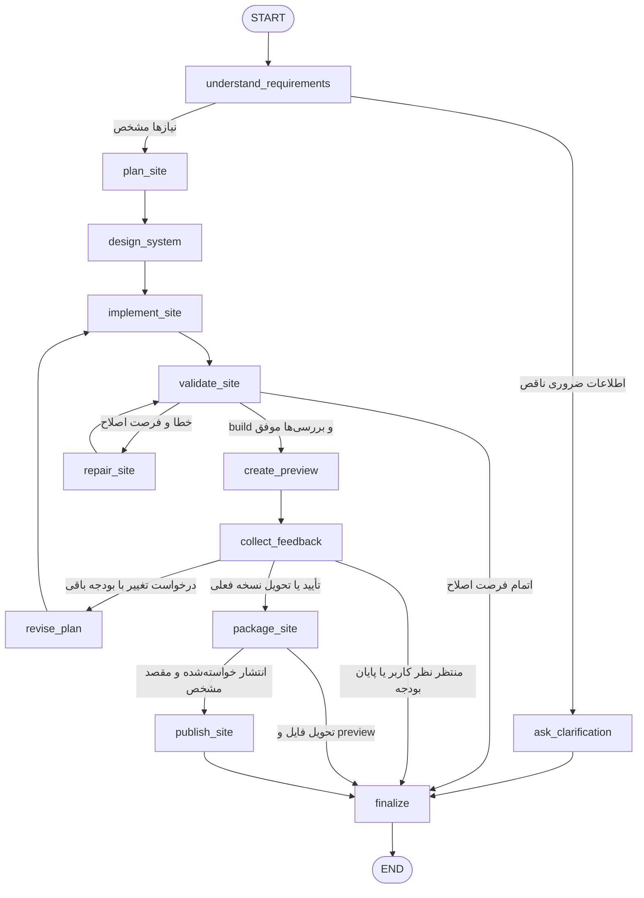

# ۴. Website Builder Agent

## هدف و فرض‌ها

تبدیل خواستهٔ کاربر به وب‌سایت قابل اجرا و قابل پیش‌نمایش. ابزار ساخت فایل در workspace، اجرای build/test و تولید preview در دسترس‌اند. انتشار عمومی فقط زمانی وارد مسیر می‌شود که کاربر آن را خواسته و مقصد مشخص است؛ در حالت عادی خروجی فایل و preview است.

## Graph

## Nodeها و تغییر State

| نود | مسئولیت | فیلدهای تغییرکرده |
|---|---|---|
| `understand_requirements` | تشخیص هدف، مخاطب، صفحات، محتوا، امکانات و مقصد انتشار | `requirements`, `needs_clarification`, `clarification_question` |
| `ask_clarification` | پرسش دربارهٔ دادهٔ ضروری؛ مثلاً نوع سایت یا قابلیت اصلی | `final_answer`, `status` |
| `plan_site` | تعیین صفحه‌ها، مسیرها، کامپوننت‌ها و معیارهای پذیرش | `site_plan`, `acceptance_criteria` |
| `design_system` | تعیین رنگ، تایپوگرافی، فاصله‌ها و رفتار responsive | `design_tokens`, `assets` |
| `implement_site` | ایجاد فایل‌ها در workspace مشخص | `files`, `implementation_notes` |
| `validate_site` | build و بررسی قابلیت‌های اصلی، اندازهٔ موبایل و دسترس‌پذیری | `validation_results`, `validation_passed`, `issues` |
| `repair_site` | رفع خطاهای مشخص و حفظ نیازهای اصلی | `files`, `repair_count` |
| `create_preview` | اجرای پیش‌نمایش و ثبت URL/تصاویر | `preview_url`, `preview_images` |
| `collect_feedback` | بررسی بازخورد موجود یا پایان برای انتظار پیام کاربر | `feedback`, `feedback_decision`, `status` |
| `revise_plan` | ترجمهٔ تغییرات کاربر به وظیفه‌های روشن | `site_plan`, `feedback_round` |
| `package_site` | آماده‌سازی نسخهٔ قابل تحویل و راهنمای اجرا | `artifact_paths`, `delivery_notes` |
| `publish_site` | انتشار نسخهٔ بررسی‌شده در مقصد مجاز | `deployment_url`, `deployment_status`, `errors` |
| `finalize` | ارائهٔ فایل/preview/URL یا توضیح خطای باقی‌مانده | `final_answer`, `status` |

## شرط‌ها و مرز توقف

- ابهام کم‌اهمیت با فرض مستند حل می‌شود؛ نیاز حیاتی نامشخص به سؤال تکمیلی می‌رود.
- validation شامل موفق شدن build و معیارهای پذیرش مرتبط است. برای هر تغییر کم‌اثر آزمون اضافی ساخته نمی‌شود.
- حلقهٔ رفع خطای خودکار حداکثر ۲ بار است. با پایان فرصت، خروجی `validation_failed` همراه نسخهٔ موجود و خطاهای باقی‌مانده ارائه می‌شود؛ نسخهٔ خراب منتشر نمی‌شود.
- preview بدون بازخورد به `awaiting_feedback` و پایان این اجرا می‌رود. ایجنت در حلقهٔ انتظار فعال نمی‌ماند؛ پیام بعدی State ذخیره‌شده را ادامه می‌دهد.
- در هر چرخه حداکثر ۲ دور اصلاح بازخورد انجام می‌شود. پس از آن نسخهٔ فعلی با وضعیت `awaiting_feedback` و توضیح کار باقی‌مانده برگردانده می‌شود تا کاربر چرخهٔ بعدی را شروع کند.
- package فقط بعد از validation موفق برای نسخهٔ فعلی است. تغییرهای بازخورد دوباره از implement و validation عبور می‌کنند.
- انتشار نیازمند `publish_requested=true` و مقصد معتبر است. شکست انتشار به `deployment_failed` می‌انجامد و فایل/preview همچنان قابل تحویل است.

## State Schema

| فیلد | نوع | معنا |
|---|---|---|
| `request` | `str` | خواستهٔ اصلی |
| `requirements` | `{goal,audience,pages,features,content,constraints}` | نیازها و فرض‌ها |
| `needs_clarification`, `clarification_question` | `bool`, `str` | دادهٔ ضروری ناقص |
| `site_plan` | `{routes,components,tasks}` | طرح ساخت |
| `acceptance_criteria` | `list[str]` | رفتارهای مورد انتظار |
| `design_tokens` | `{colors,typography,spacing,breakpoints}` | سیستم بصری |
| `assets` | `list[{path,source,usage}]` | تصاویر و دارایی‌ها |
| `workspace_path` | `str` | محدودهٔ ایجاد/اصلاح فایل |
| `files` | `list[{path,version}]` | فایل‌ها و نسخهٔ فعلی |
| `implementation_notes` | `list[str]` | فرض‌ها و تصمیم‌های فنی |
| `validation_results` | `list[{check,passed,details}]` | خروجی build و بررسی‌ها |
| `validation_passed` | `bool` | اعتبار نسخهٔ فعلی |
| `issues` | `list[str]` | خطاهای قابل اصلاح |
| `repair_count`, `max_repairs` | `int`, `int=2` | تعداد و سقف تعمیر |
| `preview_url`, `preview_images` | `str`, `list[str]` | پیش‌نمایش |
| `feedback` | `list[str]` | تغییرهای کاربر |
| `feedback_decision` | `waiting/change/approve/deliver` | مسیر بعدی |
| `feedback_round`, `max_feedback_rounds` | `int`, `int=2` | بودجهٔ تغییر هر چرخه |
| `artifact_paths`, `delivery_notes` | `list[str]`, `str` | خروجی و راهنمای تحویل |
| `publish_requested` | `bool` | خواستهٔ صریح انتشار |
| `deployment_target` | `{provider,project_id}` یا `null` | مقصد |
| `deployment_url`, `deployment_status` | `str`, `not_requested/published/failed` | وضعیت انتشار |
| `final_answer` | `str` | متن نتیجه |
| `status` | `running/needs_clarification/awaiting_feedback/ready/published/validation_failed/deployment_failed` | پایان اجرا |
| `errors`, `trace` | `list[Error]`, `list[TraceEvent]` | خطا و مسیر اجرا |

نسخهٔ فایل‌ها و validation به یکدیگر وابسته‌اند: تغییر فایل‌ها `validation_passed` را دوباره false می‌کند. نتیجهٔ بررسی نسخهٔ قبلی مجوز تحویل/انتشار نسخهٔ جدید نیست. State انتظار بازخورد باید پایدار ذخیره شود تا پیام بعدی همان preview را ادامه دهد.

## مسیر نمونه و تصمیم معماری

«یک صفحهٔ معرفی مدرس با فرم تماس بساز» → طرح → سیستم بصری → ساخت → build موفق → preview → پایان در انتظار نظر. پیام بعدی «فرم در موبایل بزرگ‌تر باشد» → revise_plan → implement → validation → preview → تأیید → package. انتشار تنها در صورت درخواست کاربر اضافه می‌شود. جدا بودن preview و publish فرصت ارزیابی نتیجه را می‌دهد؛ در مقیاس بزرگ، نسخه‌بندی artifact و محیط preview مستقل برای هر درخواست مهم می‌شود.
